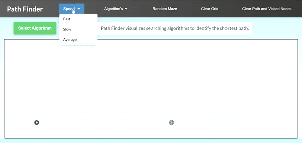

# Path Finder

Path Finder is a lightweight browser-based visualization tool for exploring common pathfinding algorithms on a grid. It helps you understand how algorithms such as Dijkstra, BFS, DFS, Best First Search, and A* explore the graph and reconstruct the shortest path step by step.

**GitHub Repository:** [Path Visualizer](https://github.com/samathur786/Path-Visualizer)



## Features

- Visualize multiple pathfinding algorithms:
  - Depth First Search (DFS)
  - Breadth First Search (BFS)
  - Best First Search
  - Dijkstra
  - A*
- Draw walls and obstacles directly on the grid
- Drag and reposition the start and end nodes
- Generate a random maze
- Adjust visualization speed
- Clear the whole grid or just the path/visited nodes
- Step-by-step animation of visited nodes and the final shortest path

## Tech Stack

- HTML
- CSS
- JavaScript

## Code Architecture

The project follows a modular JavaScript structure to keep the code
organized, maintainable, and easy to understand.

- **algorithms/**: Contains pathfinding algorithm implementations
  such as BFS, DFS, Dijkstra, A*, and Best First Search.
- **appState.js**: Manages global application variables and DOM references.
- **grid.js**: Handles grid creation.
- **gridEvents.js**: Handles grid mouse events such as dragging and selection.
- **gridInteractions.js**: Handles wall creation.
- **gridReset.js**: Handles clearing the grid and path.
- **helpers.js**: Contains reusable helper functions.
- **initialization.js**: Initializes the grid and application.
- **maze.js**: Handles random maze generation.
- **animation.js**: Handles visualization animations.
- **node.js**: Defines the node structure used in the grid and pathfinding algorithms.
- **priorityQueue.js**: Implements the priority queue used by priority-based algorithms.
- **uiControls.js**: Handles algorithm, maze, and speed controls.
- **utils.js**: Contains utility functions.
- **visualization.js**: Controls algorithm visualization.


## Getting Started

### 1. Clone the repository

```bash
git clone https://github.com/samathur786/Path-Visualizer.git
cd Path-Visualizer
```

### 2. Run the project

You can either open `index.html` directly in your browser or serve the project locally.

**Option A: Open directly**

Double-click `index.html` to open the project in your browser.

Option B: Use a local server

```bash
python3 -m http.server 8000
```

Then open:

```text
http://localhost:8000
```
## How to Use

1. Click and drag on the grid to create walls.
2. Drag the start and end nodes to change their positions.
3. Select an algorithm from the dropdown.
4. Choose a speed for the animation.
5. Click `Visualize` to see how the algorithm explores the grid.
6. Use `Clear Grid` or `Clear Path and Visited Nodes` to reset the board.

## Project Structure

```text
Path-Visualizer/
│
├── index.html
│
├── css/
│   └── style.css
│
├── js/
│   ├── algorithms/
│   │   ├── astar.js
│   │   ├── bestFirstSearch.js
│   │   ├── bfs.js
│   │   ├── dfs.js
│   │   └── dijkstra.js
│   │
│   ├── animation.js
│   ├── appState.js
│   ├── grid.js
│   ├── gridEvents.js
│   ├── gridInteractions.js
│   ├── gridReset.js
│   ├── helpers.js
│   ├── initialization.js
│   ├── maze.js
│   ├── node.js
│   ├── priorityQueue.js
│   ├── uiControls.js
│   ├── utils.js
│   └── visualization.js
│
├── start.svg
├── end.svg
├── homeAnimation1.gif
├── icon.png
└── README.md
```

## License

This project is available for educational and personal use.

